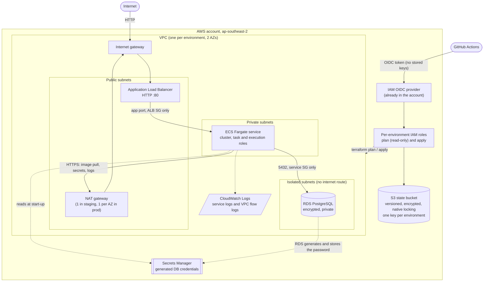

# AWS ECS Foundation (Terraform)

A clean, repeatable, two-environment AWS foundation: a VPC across two
availability zones, ECS on Fargate behind an Application Load Balancer, and a
private PostgreSQL database on RDS. Remote state with locking, and GitHub
Actions that deploy through OIDC, so there are no AWS keys anywhere.
`staging` and `prod` come from the same code; only `envs/<env>.tfvars` and the
backend key differ.

Region: `ap-southeast-2`. Terraform >= 1.10, AWS provider 6.x.

## Architecture



Traffic is only allowed along `internet -> ALB -> service -> database`; each hop
is a security-group-to-security-group rule. The database subnets have no route
to the internet at all.

## Repository layout

| Path | What it is |
|---|---|
| `versions.tf` | Terraform and provider pins, partial S3 backend (`use_lockfile = true`), `default_tags` |
| `main.tf` | Wires the modules; looks up the GitHub OIDC provider; per-environment plan and apply roles |
| `variables.tf`, `outputs.tf` | Root inputs and outputs |
| `modules/network` | VPC, public / private / isolated subnets, IGW, NAT, route tables, flow logs |
| `modules/ecs_service` | ECS cluster, ALB, Fargate service, task and execution roles, log group, security groups |
| `modules/rds_postgres` | Private encrypted PostgreSQL, subnet group, security group, RDS-managed password |
| `envs/<env>.tfvars` | Non-secret sizing and names: the only place environments differ |
| `envs/<env>.backend.hcl` | State bucket, key and region of each environment |
| `.github/workflows/terraform.yml` | Manual: checks, then plan and apply for the chosen environment |
| `.github/workflows/destroy.yml` | Manual: destroy the chosen environment |

### Staging vs prod

| Setting | staging | prod |
|---|---|---|
| VPC CIDR | `10.10.0.0/16` | `10.20.0.0/16` |
| NAT gateways | 1 shared | 1 per AZ |
| ECS tasks | 1 (256 CPU / 512 MiB) | 2 (512 CPU / 1024 MiB) |
| ALB deletion protection | off | on |
| Container Insights | off | on |
| RDS | `db.t4g.micro`, single AZ, 7-day backups | `db.t4g.small`, multi-AZ, 14-day backups |
| RDS deletion protection / final snapshot | off / skipped | on / kept |
| Flow log retention | 14 days | 90 days |

## Security model

- **No AWS keys.** GitHub Actions authenticates with OIDC. The account's
  existing GitHub OIDC provider is looked up with a data source, never created.
- **Roles per environment**, named `ecs-foundation-<env>-github-plan` and
  `...-github-apply`. Trust policies pin this exact repository (never
  `repo:owner/*`) and the audience `sts.amazonaws.com`.
- **Plan roles are provisioned but unused today.** The workflows are manual and
  run as the apply role. The read-only plan roles (trusting the
  `pull_request` subject) are kept for adding plan-on-PR later.
- **Apply is gated by the GitHub Environment.** The apply role trusts only the
  `environment:<env>` subject, so AWS itself refuses prod credentials to any job
  that did not pass the `prod` approval. There is no branch subject.
- **No passwords in code or state.** The database uses
  `manage_master_user_password = true`; the secret ARN is passed to ECS, which
  reads it at container start.
- **Least privilege.** IAM actions are scoped to `ecs-foundation-*` ARNs; every
  `"*"` resource has a comment explaining why the API needs it.
- **Tags.** Every resource gets `project`, `environment` and
  `managed_by = terraform` from the provider's `default_tags`.

## Bootstrap (once per AWS account)

Prerequisites: the AWS CLI logged in with rights to create IAM roles, Terraform
>= 1.10, and the GitHub OIDC provider already present in the account (it is
created by the TicTacToeInfra repo).

1. **Create the state bucket by hand** (it is deliberately not in Terraform):

   ```sh
   aws s3api create-bucket --bucket joheee-ecs-foundation-tfstate \
     --region ap-southeast-2 \
     --create-bucket-configuration LocationConstraint=ap-southeast-2
   aws s3api put-bucket-versioning --bucket joheee-ecs-foundation-tfstate \
     --versioning-configuration Status=Enabled
   aws s3api put-bucket-encryption --bucket joheee-ecs-foundation-tfstate \
     --server-side-encryption-configuration \
     '{"Rules":[{"ApplyServerSideEncryptionByDefault":{"SSEAlgorithm":"AES256"}}]}'
   aws s3api put-public-access-block --bucket joheee-ecs-foundation-tfstate \
     --public-access-block-configuration \
     BlockPublicAcls=true,IgnorePublicAcls=true,BlockPublicPolicy=true,RestrictPublicBuckets=true
   ```

   If you use another name, change `state_bucket_name` in `variables.tf` and the
   `bucket` line in both `envs/*.backend.hcl`.

2. **First apply of each environment, run locally.** This also creates that
   environment's CI roles, which the pipeline needs before it can run:

   ```sh
   terraform init -backend-config=envs/staging.backend.hcl
   terraform plan  -var-file=envs/staging.tfvars
   terraform apply -var-file=envs/staging.tfvars
   ```

   Repeat with `prod` when you are ready for it (use `terraform init -reconfigure
   -backend-config=envs/prod.backend.hcl` to switch).

3. **Configure GitHub** (Settings, then Environments and Variables):
   - Create the Environments `staging` (no rules) and `prod` (required
     reviewers).
   - Repository variable `AWS_REGION` = `ap-southeast-2`.
   - On each Environment, the variable `AWS_APPLY_ROLE_ARN` = that environment's
     `apply_role_arn` output.
   - Optional repository secret `INFRACOST_API_KEY` adds a monthly cost table to
     the run summary.

## Deploying

Both workflows are manual: **Actions, then pick the workflow, Run workflow, then
choose `staging` or `prod`** in the dropdown.

- **Terraform**: runs `fmt -check`, `validate`, `tflint` and `checkov`, then
  plans, writes the plan to the run summary and applies exactly that plan. The
  `prod` run waits for the Environment's reviewer approval.
- **Destroy**: type the environment name again to confirm. It disables the ALB
  and database deletion protection, then destroys the network, ECS service and
  database. The environment's CI roles are kept (they cost nothing, and the job
  runs as the apply role), so the Terraform workflow can re-create the
  environment straight away. Prod waits for approval.

### Changing the CI roles' permissions

The workflows run *as* the apply role, so the pipeline cannot reliably grant
itself new permissions: if the role lacks one, the run fails before it can
fix the role. Apply role policy changes locally first, then run the workflow:

```sh
terraform init -reconfigure -backend-config=envs/<env>.backend.hcl
terraform apply -var-file=envs/<env>.tfvars -target=aws_iam_role_policy.apply
```

Two permission details worth knowing, both found by running the pipeline:

- RDS with `manage_master_user_password` and encrypted storage needs the *caller*
  to be allowed to create the `rds!db-*` secret (`CreateSecret` is checked
  against the secret's name, not an ARN) and to use the AWS managed `aws/rds`
  and `aws/secretsmanager` keys.
- `data "aws_iam_openid_connect_provider"` needs `iam:ListOpenIDConnectProviders`
  as well as `iam:GetOpenIDConnectProvider`.

## Outputs

| Output | Meaning |
|---|---|
| `vpc_id` | VPC id |
| `azs` | Availability zones in use |
| `public_subnet_ids` | Public subnets (ALB, NAT gateways) |
| `private_subnet_ids` | Private app subnets (ECS tasks) |
| `isolated_subnet_ids` | Isolated database subnets (RDS) |
| `nat_public_ips` | Outbound source addresses of the NAT gateways |
| `flow_log_group_name` | CloudWatch log group for VPC flow logs |
| `plan_role_arn` | Read-only plan role of this environment |
| `apply_role_arn` | Apply and destroy role (GitHub Environment variable `AWS_APPLY_ROLE_ARN`) |
| `alb_dns_name` | ALB DNS name; the sample service answers here over HTTP |
| `ecs_cluster_name` | ECS cluster name |
| `ecs_service_name` | ECS service name |
| `service_log_group_name` | CloudWatch log group of the service |
| `db_address` | Database host (private, reachable only from the service) |
| `db_master_secret_arn` | Secrets Manager secret with the generated DB credentials |

Check a deployment:

```sh
curl -i "http://$(terraform output -raw alb_dns_name)"
```

## Add a third environment

1. Copy `envs/staging.tfvars` to `envs/<env>.tfvars`; set `environment` and a
   VPC CIDR that does not overlap the others.
2. Copy `envs/staging.backend.hcl` to `envs/<env>.backend.hcl` and change the
   state `key` to `<env>/terraform.tfstate`.
3. Run the first apply locally with those two files (see Bootstrap, step 2).
4. Create a GitHub Environment with that name and set its `AWS_APPLY_ROLE_ARN`.
5. Add the name to the `options` list in both workflows.

No module changes are needed.

## Destroy

Use the **Destroy** workflow for the environment. Notes:

- The CI roles stay. They are in the same state, but the workflow excludes them
  with `-target`, because the job runs as the apply role and deleting its policy
  mid-run would cut off its own state access. Re-create the environment with the
  Terraform workflow; no local step is needed.
- Prod keeps a final database snapshot named `ecs-foundation-prod-final`. Delete
  it before destroying prod a second time, or the name will clash.
- A full local teardown, roles included, is
  `terraform destroy -var-file=envs/<env>.tfvars` (turn off deletion protection
  first in prod). After that the roles must be re-created locally, see below.
- To re-create only the roles after a full teardown:

  ```sh
  terraform apply -var-file=envs/<env>.tfvars \
    -target=aws_iam_role.plan -target=aws_iam_role_policy.plan \
    -target=aws_iam_role.apply -target=aws_iam_role_policy.apply
  ```

Destroy environments after demos: NAT gateways, the ALB and RDS are the running
cost.

## Security scan (Checkov)

Checkov runs in the Terraform workflow and currently reports 18 findings
without failing the run (195 checks pass). They are accepted or planned:

| Finding | Status |
|---|---|
| ALB is HTTP-only (CKV_AWS_2, CKV_AWS_103, CKV_AWS_378, CKV2_AWS_20) | Accepted: HTTPS and a custom domain are out of scope; the obvious next step |
| ALB open to the internet on port 80 (CKV_AWS_260) | Accepted: it is the public entry point |
| No WAF on the ALB (CKV2_AWS_28) | Accepted: extra cost, out of scope |
| Container Insights off (CKV_AWS_65) | Accepted in staging for cost; on in prod |
| Log retention under 1 year (CKV_AWS_338) | Accepted: a per-environment variable, short in staging for cost |
| Log groups and Performance Insights use AWS-owned or default keys (CKV_AWS_158, CKV_AWS_354) | Accepted: a customer-managed key adds cost and key-policy upkeep |
| Writable root filesystem (CKV_AWS_336) | Accepted: the sample nginx image needs it |
| AZ data source not pinned (CKV_AWS_394) | Accepted: AZs are sliced by count |
| RDS log exports, query logging, enhanced monitoring, ALB access logs (CKV_AWS_129, CKV2_AWS_30, CKV_AWS_118, CKV_AWS_91) | Planned improvements |

## Cost per environment

> To be filled from the Infracost table in the Terraform workflow run summary
> (set `INFRACOST_API_KEY`).

| Environment | Estimated monthly cost |
|---|---|
| staging | _from Infracost_ |
| prod | _from Infracost_ |

The main drivers are the NAT gateway(s), the ALB and RDS (plus the multi-AZ
replica and extra NAT gateway in prod).

## Proof of create and destroy

> To be filled after the logged runs. Sequence: run **Destroy** for staging,
> then **Terraform** for staging (a clean create from nothing), `curl` the ALB,
> then **Destroy** again.

- Create staging from nothing: _run link_
- Sample service answering through the ALB: _output of the curl above_
- Destroy staging: _run link_

## Scope

Out of scope: EKS (the ECS module is the alternative; EKS adds roughly $73 a
month per environment), application CI/CD, HTTPS and a custom domain (the ALB
serves HTTP; ACM plus a DNS record is the obvious next step), and a
multi-account setup (both environments share one account, separated by name
prefix and state key).
